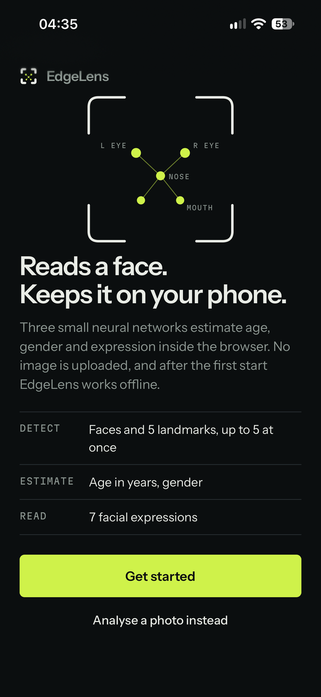
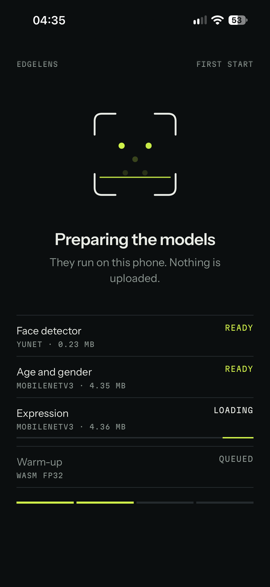
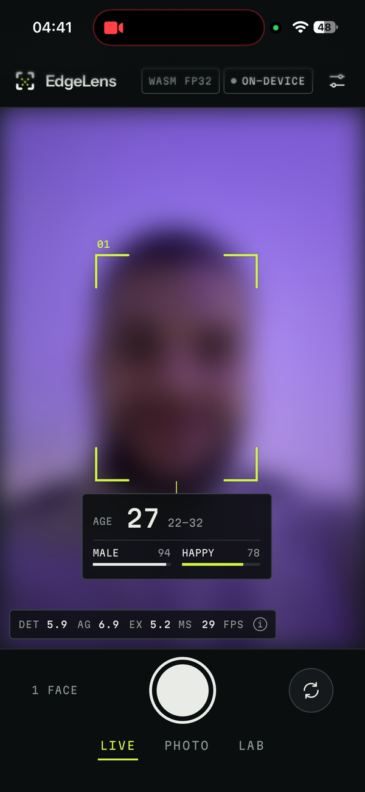
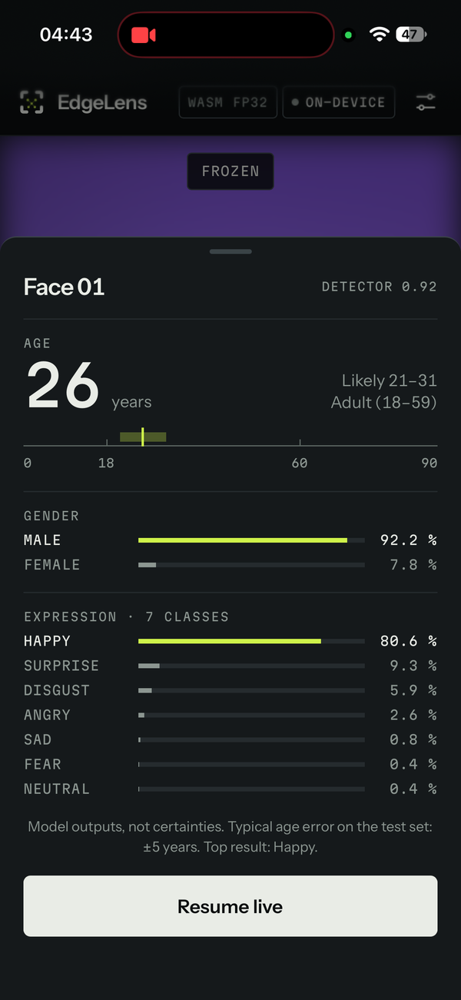
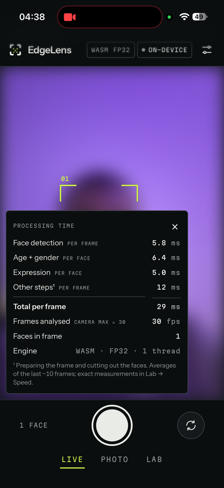
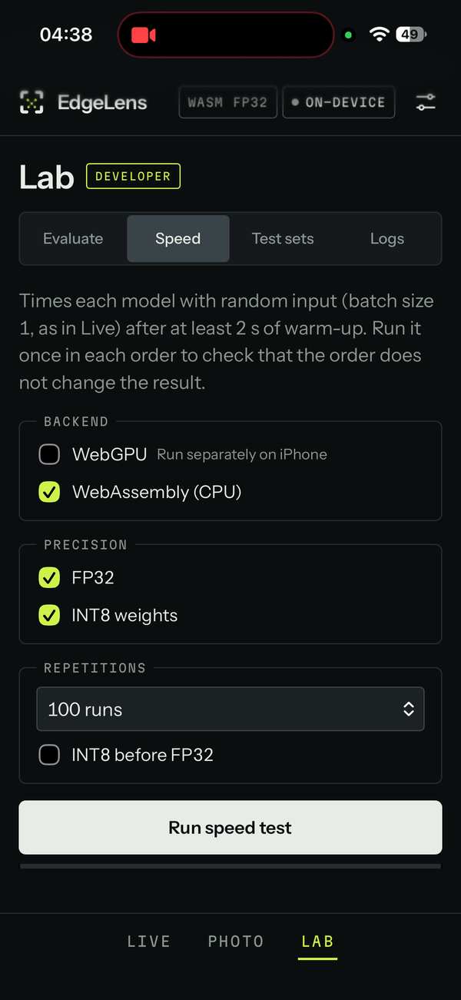

# EdgeLens – On-Device Age, Gender and Facial Expression Recognition

EdgeLens is a progressive web app (PWA) that detects faces in a camera stream or photo and estimates the
age, gender and facial expression of each face. All processing runs on the device in the browser, so
photos and camera images never leave the device. After the first visit the app also works without an
internet connection; you can check this in airplane mode. The project was developed for the course
DLBAIPEAI – Project Edge AI (Task 2) at IU International University of Applied Sciences.

EdgeLens was tested on an iPhone 15 (iOS 27.2, Safari) and in Chromium-based desktop browsers. It should
also run on other iPhones and iPads with iOS 16.4 or later (iPhone 8 and newer) and in current Android
and desktop browsers, but these were not tested.

**Try the app:** https://adevferjani.github.io/EdgeLens/ or scan the QR code with the phone camera.

<p align="center">
  <br>
  <sub>Tip: in Safari, choose Share → Add to Home Screen for full-screen and reliable offline use.</sub>
</p>

## Main features

| Mode | Function |
|---|---|
| Live | Continuous analysis of the camera stream (up to five faces). Tapping a face or the shutter freezes the frame and shows all class probabilities. |
| Photo | Analysis of a photo from the library or the camera (up to ten faces). |
| Lab | Tools used for the evaluation: labelled test photos with metrics and CSV export, on-device latency benchmark, accuracy on the public test sets, runtime information. |

Updates of the app are installed only after the user confirms them.

Screenshots from the iPhone 15 (camera picture blurred with the app's privacy setting "Blur faces on screen"):

<table align="center">
  <tr>
    <td align="center"><br><sub>Welcome screen</sub></td>
    <td align="center"><br><sub>First start: loading the models</sub></td>
    <td align="center"><br><sub>Live: age, gender, expression</sub></td>
  </tr>
  <tr>
    <td align="center"><br><sub>Frozen frame: all probabilities</sub></td>
    <td align="center"><br><sub>Live: processing time per stage</sub></td>
    <td align="center"><br><sub>Lab: on-device speed test</sub></td>
  </tr>
</table>

## System architecture

```
camera / photo ─► YuNet face detector ─► eye alignment + crop ─┬─► age + gender model ─► age, P(female)
                                                              └─► expression model ─► 7 class probabilities
                       ONNX Runtime Web (WebAssembly) in the browser
```

The two attribute models are trained in PyTorch on a PC, exported to ONNX and loaded by the web app.
The crop around each detected face is calibrated so that it matches the framing of the training
images. Details: [docs/architecture.md](docs/architecture.md).

## Technologies and models

| Component | Choice |
|---|---|
| Face detection | YuNet (Wu et al., 2023), pre-trained, 0.23 MB |
| Age and gender | MobileNetV3-Small (Howard et al., 2019), ImageNet pre-trained, fine-tuned; input 160 × 160 |
| Facial expression | MobileNetV3-Small, fine-tuned; input 112 × 112; 7 classes: angry, disgust, fear, happy, sad, surprise, neutral |
| Model format | ONNX, FP32 (4.35 MB per model) and weight-only INT8 (1.24 MB per model) |
| Runtime | ONNX Runtime Web 1.31.1, WebAssembly with up to 4 threads (WebGPU optional) |
| App | HTML, CSS and JavaScript modules without a framework or build step; service worker for offline use |
| Training | Python 3.12, PyTorch 2.15, NVIDIA RTX 4060 Laptop GPU |

## Datasets

| Dataset | Used for | Images | Split (train / validation / test) | Download |
|---|---|---|---|---|
| UTKFace (Zhang et al., 2017) | age and gender | 23,708 | 18,966 / 2,371 / 2,371, stratified by gender and age band | [Kaggle](https://www.kaggle.com/datasets/jangedoo/utkface-new) |
| FER2013 (Goodfellow et al., 2013) | facial expression | 35,887 | 28,709 / 3,589 / 3,589 (official partitions) | [Kaggle](https://www.kaggle.com/datasets/deadskull7/fer2013) |

Age is estimated from facial appearance, so the prediction reflects how old a person looks, which can
differ from the real age. Gender is predicted as one of the two labels annotated in UTKFace (male,
female). Expression recognition classifies the visible facial expression into the seven FER2013 classes;
it does not detect a person's emotional state. For the evaluation, adults are 18–59 years and elderly
people 60 years or older. The datasets are not part of this repository; how to download and place them
is described in [docs/reproducibility.md](docs/reproducibility.md).

## Results

Test-set results of the deployed models and a limited practical evaluation with 20 own photos.
Methodology and all tables: [docs/results/evaluation-table.md](docs/results/evaluation-table.md).

| Metric | PC, ONNX Runtime, FP32 | iPhone 15, FP32 | iPhone 15, 20 own photos |
|---|---|---|---|
| Age group adult vs. 60+ (age 18+), accuracy | 93.1 % | 93.1 % | 95 % (19/20) |
| Age, mean absolute error | 5.08 years | 5.08 years | 4.1 years |
| Gender, accuracy | 94.1 % | 94.0 % | 85 % (17/20) |
| Expression, 7 classes, accuracy | 68.4 % | 68.4 % | 65 % (13/20) |
| Happy vs. sad (forced choice), accuracy | 91.0 % | 91.0 % | 95 % (19/20) |
| Inference per model, age + gender / expression | 1.9 / 1.8 ms (mean) | 6.3 / 4.1 ms (median) | – |

On the iPhone the full pipeline for one face (detection, cropping and both models) takes 25.7–27.3 ms
(median), so Live mode keeps up with the 30 fps camera. Weight-only INT8 reduces the model files by
72 % at the same accuracy but does not reduce the inference time
([docs/results/quantization.md](docs/results/quantization.md)).

## Installation and usage

**On the iPhone:** open the app address in Safari, choose Share → Add to Home Screen, start EdgeLens
from the home screen, tap Get started and allow camera access.

**On a PC:** the app can be served locally and opened in Chrome or Edge (camera access works on
`localhost`):

```powershell
python -m http.server 8000 -d pwa
```

Setting up the Python environment, training, export, evaluation, tests and deployment are described
step by step in [docs/reproducibility.md](docs/reproducibility.md).

## Limitations

The models perform worst for elderly people: only about 11 % of the UTKFace training images show people
aged 60 or older, and on the test set 69.5 % of them are assigned to the elderly group (adults: 96.8 %).
Expression accuracy is limited by FER2013, which consists of small 48 × 48 grayscale images on which
humans reach about 65 % (Goodfellow et al., 2013); fear and sad are the weakest classes (F1 0.53 and
0.54). Performance across ethnic groups was not evaluated. The practical evaluation with 20 photos shows
that the app works on new images, but it is too small for reliable conclusions about generalisation (one
photo changes a percentage by 5 points).

## Privacy

Images are analysed only on the device; the app downloads its files and models but sends no image
data over the network. The 20 test photos were deleted after the evaluation, and the exported
results contain anonymous IDs only. Dataset images are not included in the repository.

## Repository structure

```
pwa/          web app (deployed unchanged), including the ONNX models in pwa/models/
training/     training, evaluation, ONNX export and quantisation scripts
tests/        automated checks of the training code, the models and the web app
runs/         training and evaluation outputs (metrics, histories; no checkpoints)
splits/       fixed UTKFace data split
docs/         architecture, reproducibility and results
```

The source code is licensed under the MIT licence ([LICENSE](LICENSE)). Third-party components keep their own
licences ([THIRD_PARTY_NOTICES.md](THIRD_PARTY_NOTICES.md)). The trained models in `pwa/models/` were trained on
UTKFace and FER2013 and are intended for non-commercial research and education only.

## References

Goodfellow, I. J., Erhan, D., Carrier, P. L., Courville, A., Mirza, M., Hamner, B., Cukierski, W., Tang, Y.,
Thaler, D., Lee, D.-H., Zhou, Y., Ramaiah, C., Feng, F., Li, R., Wang, X., Athanasakis, D., Shawe-Taylor, J.,
Milakov, M., Park, J., … Bengio, Y. (2013). *Challenges in representation learning: A report on three machine
learning contests*. arXiv. https://doi.org/10.48550/arXiv.1307.0414

Howard, A., Sandler, M., Chu, G., Chen, L.-C., Chen, B., Tan, M., Wang, W., Zhu, Y., Pang, R., Vasudevan, V.,
Le, Q. V., & Adam, H. (2019). Searching for MobileNetV3. In *Proceedings of the IEEE/CVF International
Conference on Computer Vision* (pp. 1314–1324). IEEE. https://doi.org/10.1109/ICCV.2019.00140

Wu, W., Peng, H., & Yu, S. (2023). YuNet: A tiny millisecond-level face detector. *Machine Intelligence
Research, 20*(5), 656–665. https://doi.org/10.1007/s11633-023-1423-y

Zhang, Z., Song, Y., & Qi, H. (2017). Age progression/regression by conditional adversarial autoencoder.
In *Proceedings of the IEEE Conference on Computer Vision and Pattern Recognition* (pp. 5810–5818). IEEE.
https://doi.org/10.1109/CVPR.2017.463
